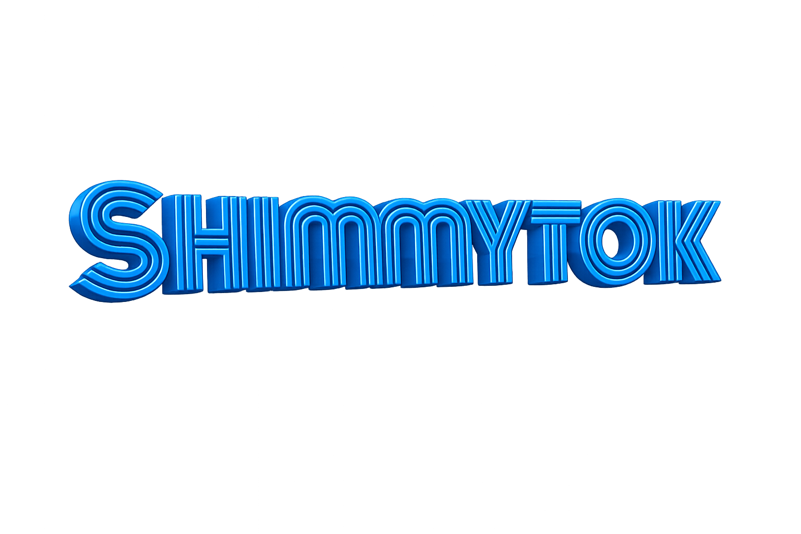

<div align="center">



### Pure Rust tokenizer for GGUF models
**ShimmyTok 0.8.5 • checked GGUF metadata • fixture-scoped compatibility**

[](LICENSE-MIT) [](https://translifeline.org/) [](https://www.thetrevorproject.org/)
[](https://crates.io/crates/shimmytok)
[](https://rustup.rs/)
[](https://github.com/sponsors/Michael-A-Kuykendall)

</div>

---

**shimmytok is free forever.** Choose MIT OR Apache-2.0 and retain the applicable license notices.

### Support

This project is independently maintained and free forever. Sponsorship helps fund ongoing development, certification, compatibility work, and releases.

[Sponsor on GitHub](https://github.com/sponsors/Michael-A-Kuykendall) · [Buy Me a Coffee](https://www.buymeacoffee.com/michaelakuykendall)

Any amount is appreciated. Suggested tiers:

- **$5/month** — Thanks
- **$15/month** — Supporter
- **$50/month** — Backer
- **Custom** — [Email for invoicing](mailto:michaelallenkuykendall@gmail.com)

---

## ShimmyTok 0.8.5

ShimmyTok is a Rust library for loading GGUF tokenizers. This release shares a
checked GGUF manifest parser with Airframe, preserves the existing tokenizer API,
and adds permanent malformed-array allocation regression tests. See the
[versioned changelog](CHANGELOG.md) and [parser security notes](docs/GGUF_SECURITY.md).

Tokenizer support is not inference support. Reading a vocabulary or recognizing a
model name does not certify its neural-network execution in Airframe or Shimmy.
Compatibility comparisons apply to the exact tested fixtures and options; there
is no universal llama.cpp parity guarantee.

## Implementation coverage

The current dispatcher in `Tokenizer::from_vocab` selects these implementations:

| GGUF tokenizer model | Implementation |
|---|---|
| `llama`, `mistral`, `gemma`, `gemma4`, `gemma6` | SentencePiece |
| `gpt2`, `qwen`, `qwen2` | BPE |
| `bert`, `wpm` | WordPiece |
| `rwkv` | RWKV |
| `t5`, `ugm` | Unigram |
| `plamo2` | PLaMo-2 |

Other tokenizer-model values return an unsupported-model error. Implementation
availability is separate from independent token-for-token fixture validation.
A family name is not a promise that every vocabulary, normalization rule or
pre-tokenizer revision is compatible.

## Installation

After 0.8.5 is published, add the library to a Rust project:

```bash
cargo add shimmytok@0.8.5
```

Or use:

```toml
[dependencies]
shimmytok = "0.8.5"
```

This package is a library, not a `cargo install` command-line application.
The default `parallel` feature enables optional Rayon batch processing.
`default-features = false` selects the sequential batch implementation.

## Quick Start

Use an existing GGUF file containing a supported tokenizer:

```rust
use shimmytok::{EncodeOptions, Tokenizer};

fn main() -> Result<(), shimmytok::Error> {
    let tokenizer = Tokenizer::from_gguf_file("model.gguf")?;
    let options = EncodeOptions::with_parse_special(true, true);
    let ids = tokenizer.encode_with_options("Hello, world!", &options)?;
    let decoded = tokenizer.decode(&ids, true)?;
    println!("{decoded}");
    Ok(())
}
```

Choose special-token options to match the actual model/template contract. Avoid
adding a second BOS to a prompt whose template already supplies it. Explicit
GGUF special-token metadata takes precedence over family defaults; this release
does not add another BOS-default correction.

## API and compatibility

`encode`, `encode_with_options`, `decode`, `decode_single`, `encode_batch`,
`get_token`, special-token accessors and read-only `metadata` remain available.
See the [API stability contract](docs/API_STABILITY.md) for signatures, opt-in
external-special-token behavior and upgrade boundaries.

Batch output preserves input order; each item follows the corresponding single
encode operation. The sequential/parallel error contract selects the lowest
failing input index. No new universal performance or cross-platform
certification is implied by those API contracts.

The coordinated dense-inference fixtures use exact Qwen3 and Llama model/token
hashes and reference conditions documented by
[Shimmy](https://github.com/Michael-A-Kuykendall/shimmy/blob/main/docs/SUPPORTED_MODELS.md).
Those engine tests do not certify every tokenizer implementation above against
every llama.cpp revision. New models require their own exact-ID comparisons,
including normalization, added tokens, byte fallback and prompt framing.

## Security and platforms

The public GGUF reader validates declared lengths, tensor bounds/alignment and
checked allocation budgets before consuming untrusted payloads. The permanent
[security regression](docs/GGUF_SECURITY.md) exercises impossible array counts,
budgets, overflow and truncation alongside a valid bounded vocabulary.
These checks do not make arbitrary model files harmless or provide unbounded
resource guarantees for every tokenizer algorithm.

Local package tests ran on Linux under WSL. Other native platforms, WASM/WASI
and minimum-toolchain certification are NOT_RUN in this release record.
Rust portability or a sequential code path is not evidence of execution on a
particular target. Use source builds and report exact target/toolchain failures.

## Links

- **📖 [CHANGELOG](CHANGELOG.md)** — Version history  
- **🗺️ [ROADMAP](ROADMAP.md)** — Future plans
- **🤝 [CONTRIBUTING](CONTRIBUTING.md)** — How to contribute
- **🔒 [SECURITY](SECURITY.md)** — Vulnerability reporting
- **📚 [docs.rs](https://docs.rs/shimmytok)** — API documentation

## Related Projects

- **[llama.cpp](https://github.com/ggerganov/llama.cpp)** — Reference C++ implementation
- **[GGUF spec](https://github.com/ggerganov/ggml/blob/master/docs/gguf.md)** — File format documentation

## License

Dual-licensed **MIT OR Apache-2.0** — free forever, no strings attached.

---

**Maintainer**: Michael A. Kuykendall  
**Mission**: Pure Rust tokenization for the LLM ecosystem

## Support

This project is a safe space. Trans rights are human rights.

If you or someone you love needs support:

- [The Trevor Project](https://www.thetrevorproject.org/) — 24/7 for LGBTQ+ young people. Call 1-866-488-7386 or text START to 678-678
- [Trans Lifeline](https://translifeline.org/) — peer support run by and for trans people. US: 877-565-8860
- [988 Suicide & Crisis Lifeline](https://988lifeline.org/) — call or text 988
